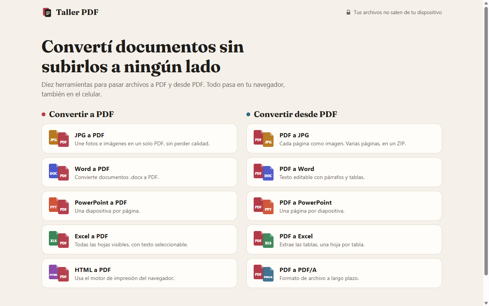
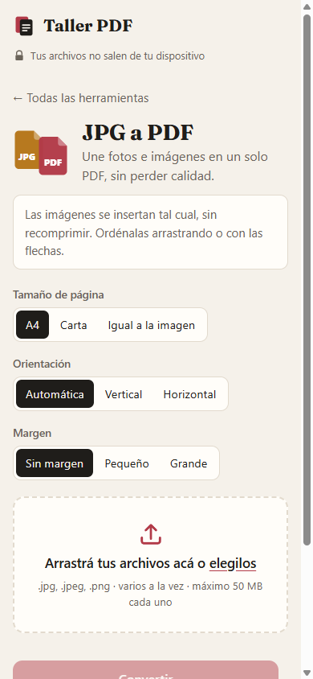

# Taller PDF

Diez herramientas para pasar archivos a PDF y desde PDF. **Todo se procesa en el navegador**: los archivos nunca salen de tu dispositivo. Anda en la compu y en el celular, sin instalar nada.

**[Abrir Taller PDF →](https://fran951xd.github.io/convertidor/)**



## El problema

Los conversores online gratuitos piden subir el archivo a un servidor ajeno. Para un contrato, un recibo de sueldo o un DNI escaneado, eso es regalar datos personales. Taller PDF hace las mismas conversiones con librerías que corren en el navegador, así que no hay servidor que vea los archivos.

## Herramientas

| Convertir a PDF | Convertir desde PDF |
|---|---|
| JPG/PNG a PDF | PDF a JPG (150/300/600 ppp, ZIP) |
| Word (.docx) a PDF | PDF a Word (.docx) |
| PowerPoint (.pptx) a PDF | PDF a PowerPoint (idéntico o editable) |
| Excel (.xlsx/.xls) a PDF | PDF a Excel (una hoja por tabla) |
| HTML a PDF | PDF a PDF/A (1b, 2b o 3b) |

<p align="center"></p>

## Decisiones técnicas

- **Sin servidor ni compilación.** HTML, CSS y JavaScript; se publica en GitHub Pages tal cual.
- **Librerías bajo demanda.** Cada herramienta descarga solo lo que necesita la primera vez que se usa (Ghostscript pesa 16 MB y únicamente lo pide PDF/A), así la portada carga al instante.
- **Validación por contenido, no por extensión.** Se lee la firma real del archivo: un PNG renombrado a `.pdf` se rechaza con un mensaje claro, igual que un PDF dañado, uno con contraseña o un Office cifrado.
- **Fotos del celular bien orientadas.** JPG a PDF lee la rotación EXIF y no recomprime las imágenes.
- **PDF a Excel detecta tablas** agrupando el texto por filas y columnas alineadas, y entiende números con formato argentino (`1.234,56`) e inglés (`1,234.56`).
- **PDF/A con Ghostscript en WebAssembly**, con una validación básica del resultado (metadatos XMP, perfil de color, fuentes incrustadas).
- **Memoria acotada en el celular.** Las páginas muy grandes a 600 ppp se reducen y la página avisa cuando pasa.
- **Pruebas automáticas en un navegador real.** `tests.html` genera sus propios docx, pptx, xlsx y PDF de prueba, corre las 10 conversiones y los casos de error, y la CI lo ejecuta en Chromium en cada push.

## Calidad y limitaciones de cada herramienta

| Herramienta | Calidad | Limitaciones |
|---|---|---|
| JPG a PDF | Idéntica | Las imágenes se insertan sin recomprimir (las PNG, sin pérdida). |
| Word a PDF | Aproximada | El navegador dibuja el documento ([docx-preview](https://github.com/VolodymyrBaydalka/docxjs)). Las fuentes que no tenga el dispositivo se reemplazan, el texto queda como imagen y los saltos de página pueden no coincidir con los de Word. |
| PowerPoint a PDF | Básica | Texto, imágenes, formas, tablas, gráficos y fondos simples. Efectos, SmartArt, degradados complejos y fuentes especiales pueden verse distintos. |
| Excel a PDF | Buena para datos | Texto seleccionable. Respeta hojas ocultas, área de impresión, orientación y escala. No conserva colores de celda, bordes personalizados ni gráficos. |
| HTML a PDF | Idéntica (motor del navegador) | Abre el diálogo de impresión: hay que elegir «Guardar como PDF». No acepta URL (el navegador no deja leer otras webs). |
| PDF a JPG | Idéntica | En celulares, las páginas muy grandes a 600 ppp se reducen por límite de memoria. |
| PDF a Word | Aproximada | Recupera texto, tamaños, negritas, párrafos y tablas simples. No copia imágenes. |
| PDF a PowerPoint | Idéntico / aproximado | Idéntico: cada página como imagen. Editable: el texto en cuadros en su posición, sin imágenes ni formas. |
| PDF a Excel | Buena con tablas simples | Si no encuentra tablas, lo dice. Celdas combinadas o columnas poco claras pueden salir mal. |
| PDF a PDF/A | Buena | Para una certificación formal conviene validar con [veraPDF](https://verapdf.org). |

Límites comunes: 50 MB por archivo. Los PDF escaneados (sin texto) no se pueden pasar a Word, Excel ni PowerPoint editable.

## Cómo correrlo

No anda abriendo `index.html` con doble clic (el navegador bloquea parte de los componentes). Con cualquier servidor estático:

```bash
git clone https://github.com/Fran951xD/convertidor.git
cd convertidor
python -m http.server 8000      # http://localhost:8000
```

Hace falta internet la primera vez que se usa cada herramienta, porque las librerías se cargan desde CDN.

## Pruebas

Abrí `http://localhost:8000/tests.html`, o corrélas sin ventana como en la CI:

```bash
npm install --no-save playwright && npx playwright install chromium
node scripts/pruebas-navegador.mjs
```

Son 22 pruebas: cada conversión produce un archivo que se abre y tiene las páginas, diapositivas u hojas esperadas, más los errores (PDF dañado, escaneado, extensión falsa, Office protegido y formato no válido).

## Estructura

```
index.html                   portada y páginas de herramienta (rutas #/jpg-pdf, #/word-pdf, …)
css/styles.css               diseño (claro/oscuro, adaptable al celular)
js/converters.js             las 10 conversiones y las validaciones
js/app.js                    interfaz: arrastrar y soltar, progreso, vista previa, descarga
tests.html, js/tests.js      pruebas automáticas en el navegador
scripts/pruebas-navegador.mjs  corre tests.html en Chromium (CI)
```

## Próximos pasos

- OCR para PDF escaneados (por ejemplo, con Tesseract.js).
- Funcionar sin conexión, guardando las librerías en el propio repositorio.

## Licencias

Código propio bajo licencia MIT. Librerías de terceros: pdf-lib (MIT), PDF.js (Apache 2.0), JSZip (MIT), PptxGenJS (MIT), docx (MIT), docx-preview (Apache 2.0), SheetJS Community (Apache 2.0), html2canvas (MIT), jsPDF y jsPDF-AutoTable (MIT), pptx-preview (uso libre según su autor) y Ghostscript WASM (AGPL-3.0, por eso el código del sitio es público).
